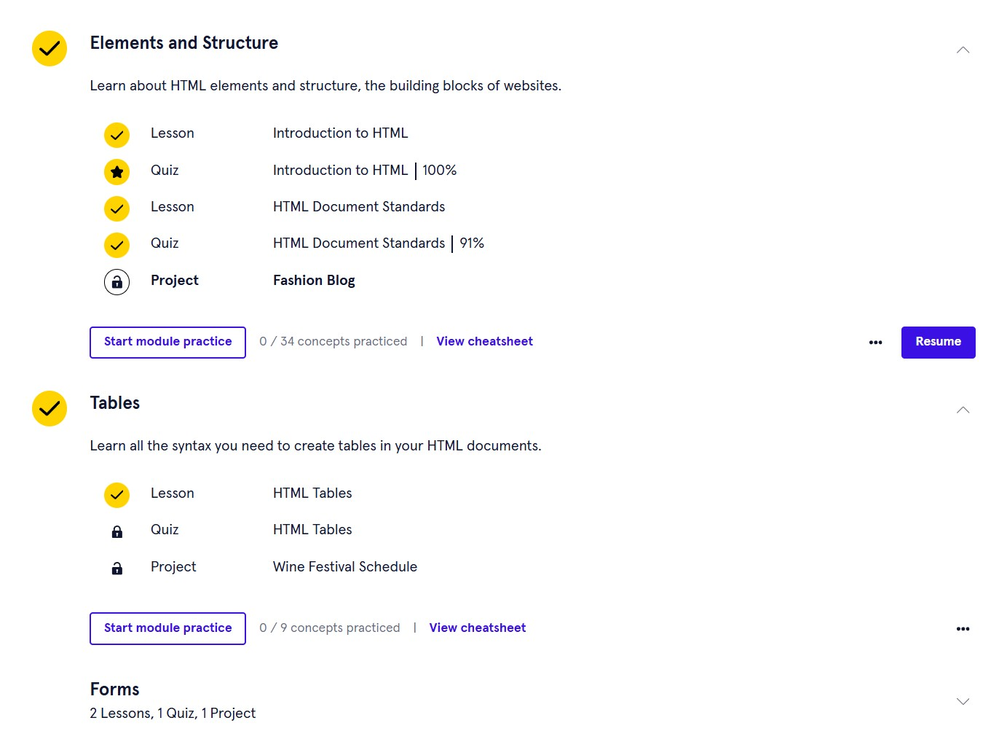
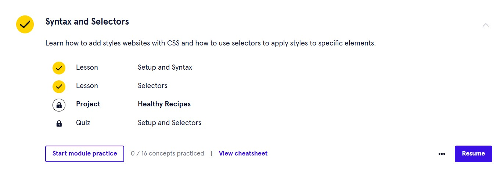
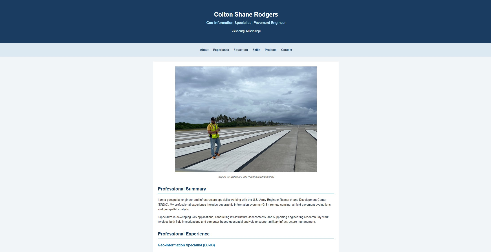

## Lab 3 - Build Your Web Resume

### Overview
This lab introduces HTML and CSS through the development
of a professional resume website.

### Task 1 - Codecademy Tutorials
Completed the assigned lessons on Codecademy: HTML lesson 1: Elements and Structures & lesson 2: Tables; CSS lesson 1: Selectors and Visual Rules.

**HTML Completion:**

**CSS Completion:**

### Task 2 - Professional Web Resume
Created a personal resume website using HTML and CSS.

The website includes:
- Professional summary
- Employment experience
- Education
- Technical skills
- GIS projects
- Contact information
- Airfield photograph

### Website Files
[View Resume HTML](Resume_Colton_Rodgers.html)

[View Airfield Photograph](airfield.jpg)

[View Word Document](ColtonS.Rodgers_Resume_2026.docx)

### Completed Website Screenshot

