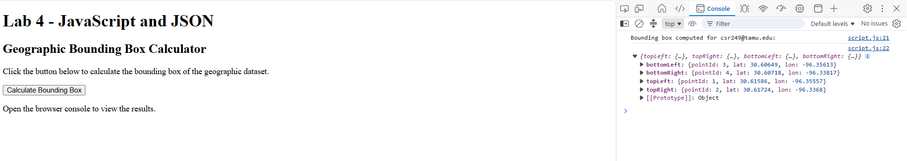

# Lab 4 – JavaScript and JSON Programming

**Course:** GEOG 678 – Web GIS  
**University:** Texas A&M University

## Overview

This lab introduces JavaScript and JSON programming for web-based geographic applications. The assignment involves creating an HTML webpage, linking JavaScript files, and using functions to identify geographic corner points from a dataset.

## Objectives

- Learn basic JavaScript and JSON programming.
- Create an HTML webpage with an interactive button.
- Link external JavaScript files to an HTML document.
- Use functions, objects, arrays, and conditional statements.
- Identify the four corner points of a geographic dataset.
- Display the results in the browser console.

## Lab Files

- **HTML File:** [index.html](index.html)
- **JavaScript File:** [script.js](script.js)
- **Data File:** [data.js](data.js)

## Console Output

The screenshot below documents the JavaScript console output displaying the student email address and output object.

## Lab Activities

1. Reviewed the JavaScript and JSON programming instructions.
2. Created an HTML document and linked an external JavaScript file.
3. Developed JavaScript functions using objects and arrays.
4. Applied programming logic to process data.
5. Worked with geographic bounding box information.
6. Tested the JavaScript code using the browser's developer console.
7. Captured a screenshot of the required console output.
8. Uploaded the HTML, JavaScript, data, and screenshot files to GitHub.

## Deliverables

- HTML file containing the webpage
- JavaScript file
- Geographic dataset
- Screenshot of the console output showing the email address and output object
- Link to the Lab_04 GitHub folder submitted through Canvas
is lab provides an introduction to JavaScript and JSON programming for web-based geographic applications. The exercises demonstrate how functions, objects, arrays, and conditional statements can be used to organize and process information. These concepts provide a foundation for developing interactive Web GIS applications.
