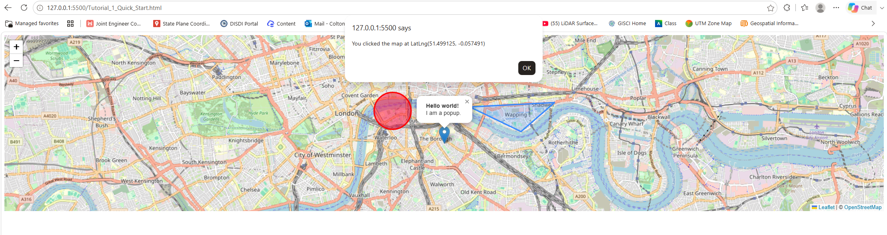
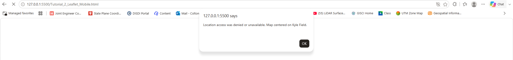
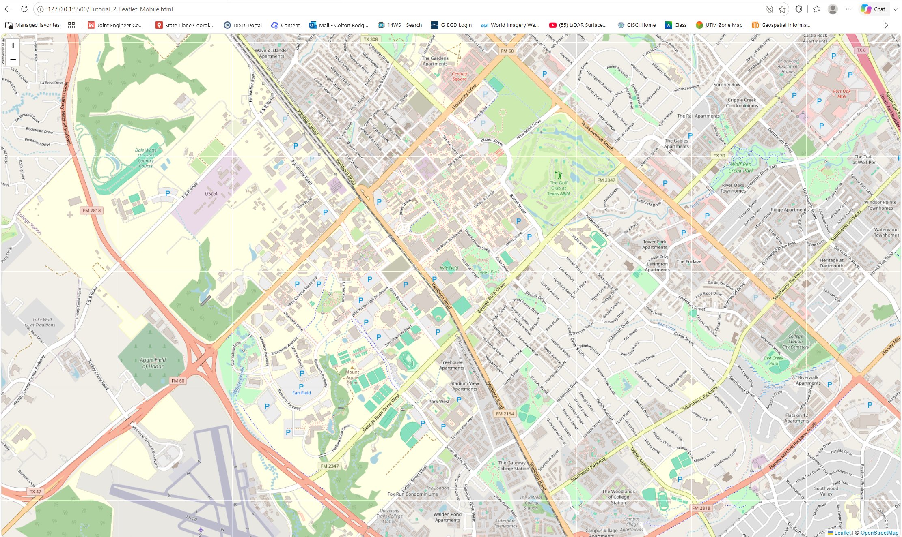
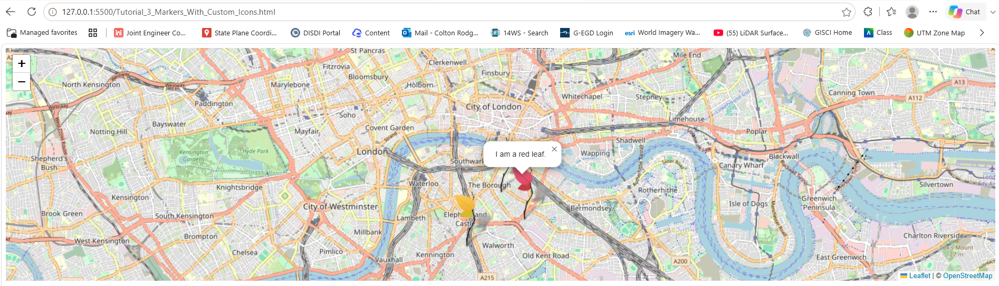
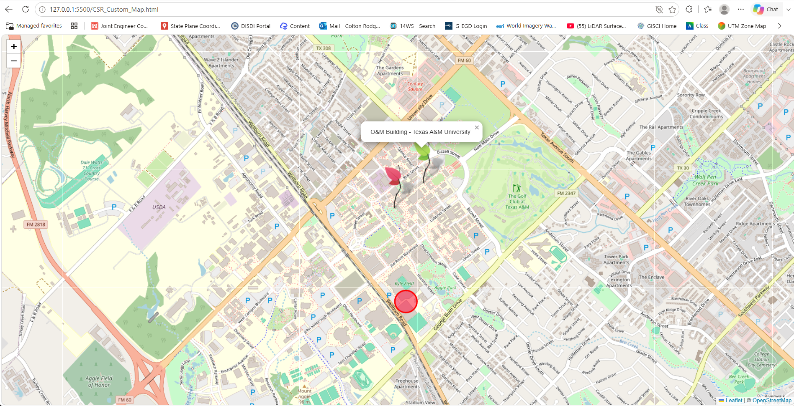

# Lab 5 - Basic JavaScript Mapping with Leaflet

**Course:** GEOG 678 - Web GIS  
**University:** Texas A&M University

## Overview

The purpose of this lab is to develop interactive web mapping applications using Leaflet, an open-source JavaScript library. This lab introduces the fundamentals of creating web maps, displaying geographic features, and implementing user interactions through JavaScript.

## Objectives

- Create interactive web maps using Leaflet.
- Add geographic markers, polylines, and popups.
- Implement map events and user interactions.
- Develop a custom web map using JavaScript.
- Display geographic coordinates through interactive map functions.
- Document and organize web mapping applications using GitHub.

## Leaflet Tutorials

Three introductory Leaflet tutorials were completed to demonstrate basic web mapping functionality.

### Tutorial 1 - Leaflet Quick Start Guide

Created an interactive OpenStreetMap map centered on London. Added a marker, circle, and polygon with popups, along with a map click event that displays geographic coordinates.

**HTML File:**

[Tutorial 1](Tutorial_1_Quick_Start.html)

**Screenshot:**

### Tutorial 2 - Leaflet on Mobile

This tutorial demonstrates how to create a mobile-friendly, full-screen Leaflet map using browser geolocation.

The map uses the `map.locate()` function to attempt to identify the user's geographic location. Location success and error event handlers were implemented.

Browser geolocation access was unavailable during testing (computer admin rights on current computer), a fallback function was included to center the map on Kyle Field at Texas A&M University.

**HTML File:**

[Tutorial 2](Tutorial_2_Leaflet_Mobile.html)

**Geolocation Failure Screenshot:**

**Kyle Field Fallback Screenshot:**

### Tutorial 3 - Markers with Custom Icons

This tutorial introduces the creation of customized map markers using Leaflet.

**HTML File:**

[Tutorial 3](Tutorial_3_Markers_With_Custom_Icons.html)

**Screenshot:**

## Custom Leaflet Web Map

The final assignment involves developing a custom interactive web map that combines the concepts introduced in the three Leaflet tutorials.

The custom map displays locations on the Texas A&M University campus, including Kyle Field, the O&M Building, and the Academic Building.

**HTML File:**

[Custom Leaflet Web Map](CSR_Custom_Map.html)

### Custom Map Features

The custom web map incorporates the following functionality:

1. **Location Function:** Allows the map to identify or navigate to a geographic location. If location access is unavailable (due to security reasons with admin rights on current computer), the map centers on Kyle Field.

2. **Circle with Pop-up:** Displays a circular feature around Kyle Field with an associated popup.

3. **Custom Icons with Popups:** Uses customized markers to display information for the O&M Building and Academic Building when selected.

4. **Coordinate Display Event:** Displays geographic coordinates in a popup when the user interacts with the map.

### Custom Map Screenshot

## Technologies Used

- HTML5
- CSS
- JavaScript
- Leaflet 1.9.4
- OpenStreetMap
- Visual Studio Code
- Live Server
- GitHub
